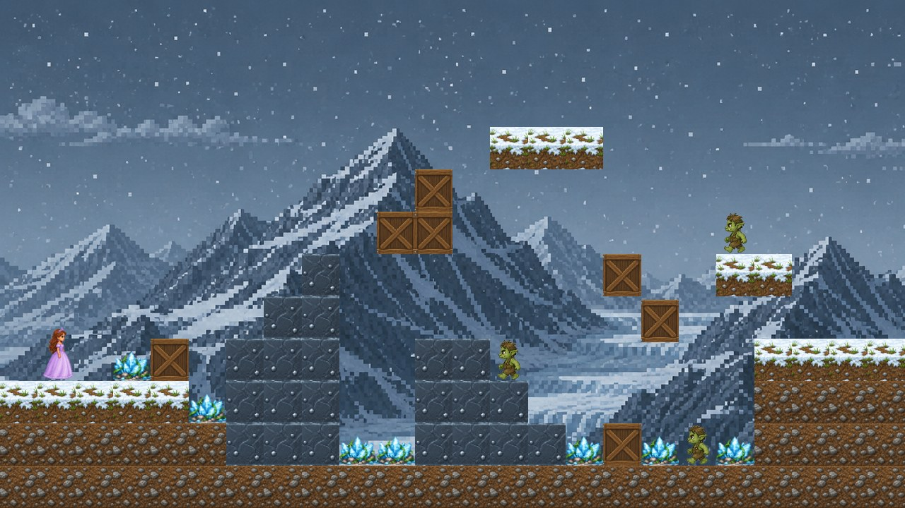
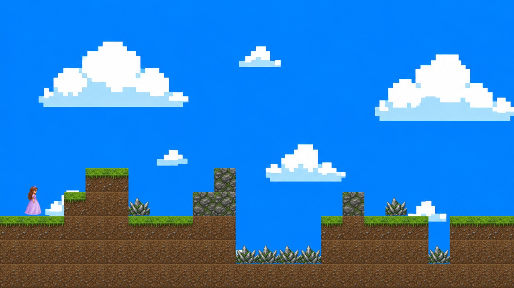
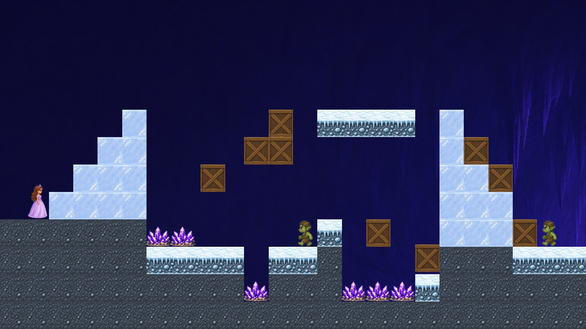
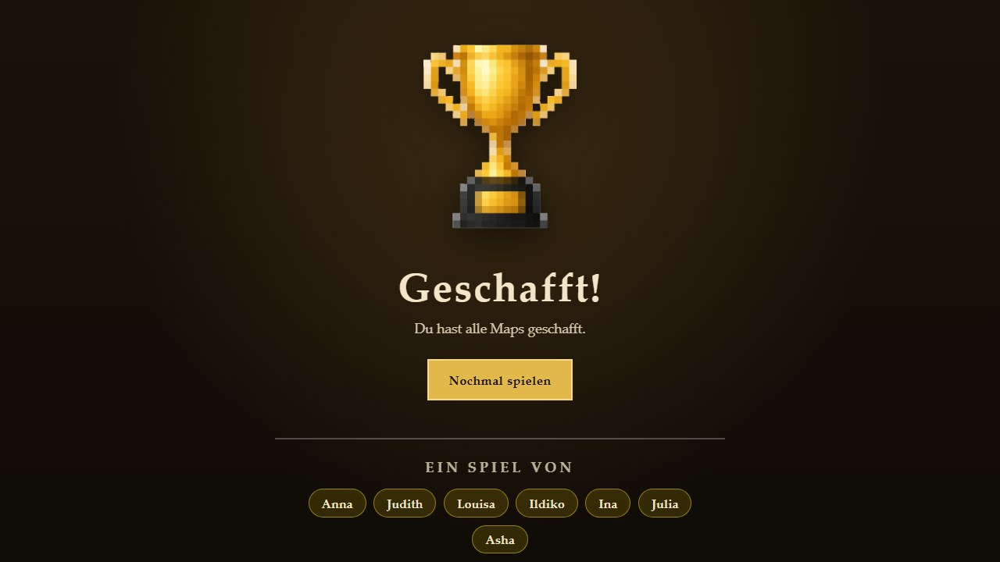

<div align="center">

# 👑 Prinzessinnen-Jump'n'Run

**Ein Browser-Jump'n'Run in Pixel-Optik – in 3 Tagen im Rahmen von SAP Game Programming 2026 gebaut.**

Lauf mit der Prinzessin durch drei Welten, weich Stacheln und Kobolden aus und finde das Portal zum nächsten Level.




</div>

---

## 🎮 Spielen

Es gibt nichts zu installieren – das Spiel ist reines HTML, CSS und JavaScript.

```bash
git clone https://github.com/Jasper-Claus/SAP_Game-Programming_2026.git
cd SAP_Game-Programming_2026
python -m http.server 8000
```

Dann im Browser **http://localhost:8000** öffnen – du landest direkt in Level 1.

> 💡 Ein lokaler Server ist empfohlen. Direkt per Doppelklick auf `mapOne/mapOne.html` geht es meistens auch, manche Browser blockieren dann aber Dateien.

### Steuerung

| Taste | Aktion |
| :---: | --- |
| <kbd>A</kbd> | nach links laufen |
| <kbd>D</kbd> | nach rechts laufen |
| <kbd>W</kbd> | springen |

Stacheln und Kobolde kosten ein Leben – das Level startet dann neu. Das Portal am Ende bringt dich ins nächste Level.

## 🗺️ Die Level

| Level 1 – Grasland | Level 2 – Schneeberge |
| :---: | :---: |
|  |  |
| **Level 3 – Eishöhle** | **Geschafft!** |
|  |  |

## 📁 Projektstruktur

```text
.
├── index.html               # Einstieg, leitet zu Level 1 weiter
├── mapOne/                  # Level 1 – Grasland (HTML, CSS, Map-Logik, Tiles)
├── mapTwo/                  # Level 2 – Schneeberge
├── mapThree/                # Level 3 – Eishöhle
├── bewegung-steuerung/      # Spielerbewegung, Physik, Kollisionen, Animation
├── win/                     # Gewinnbildschirm mit Credits
├── img/                     # Sprites: Prinzessin, Kobold, Pokal, Portal …
└── docs/screenshots/        # Bilder für diese README
```

Jedes Level baut seine Karte in `mapX.js` aus einem Raster von Tile-Codes auf. `bewegung.js` wird danach geladen und kümmert sich um Laufen, Springen, Schwerkraft und alle Kollisionen.

## 👩‍💻 Team

Das Spiel ist in vier Teams entstanden:

| Team | Aufgabe |
| --- | --- |
| **1 – Aussehen der Figur** | Prinzessin, Prinz, Kobold, Münze, Game-Over- und Gewinnbildschirm |
| **2 – Bewegung & Steuerung** | Laufen, Springen, mitlaufende Kamera |
| **3 – Spielfeld** | Erd-, Stein- und Grasblöcke, Kisten, Stacheln, Hintergründe |
| **4 – Spiellogik** | Kollisionen mit Wänden, Kobolden und Items, Gewinn- und Verlierbedingungen |

Mit dabei: Anna, Asha, Ildiko, Ina, Jasper, Judith, Julia und Louisa.

---

<div align="center">
<sub>SAP Game Programming 2026 · gebaut mit ❤️ und viel Pixel-Art</sub>
</div>
